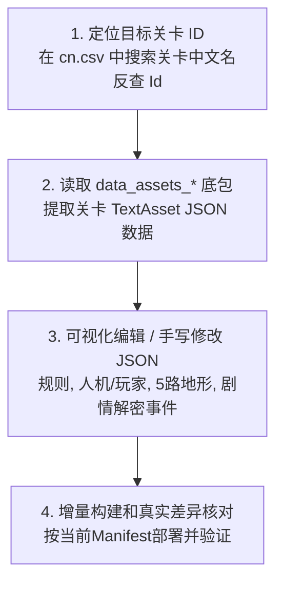

# 09. 关卡修改

**从[关卡资料索引](INDEX.md)开始。** 2026-10-25起当前范围锁定植物／僵尸任务1～200；索引统一登记资料优先级、已纠错内容、工具限制与正式任务实验状态，避免反复从旧示例猜测。按需调用与维护规则见[05](05.资料纠错与按需调用规则.md)。

在 PVZH 中，单人战役、英雄关卡与解密挑战（Puzzle Party）的所有数据均存放在 `data_assets_*` 资源包内。

本章节详细讲解 PVZH 关卡数据的存储机制、JSON 属性结构、剧情与解密发牌事件配置，以及基于社区工具 [PVZH-Level-Editor](https://github.com/Show-o4210/PVZH-Library/tree/main/tools/level-editor) 的可视化编辑与打包注入流程。

> 2026-10-25纠错：01～04已纠正旧字段、事件类型和“权重必须100／最大编号优先”等误导。代码摘录仍不是完整导入模板。历史僵尸200案例见[Agent关卡指南](../agents/03-levels-and-localization.md)，新专项事实见[筛选摘要](关卡事实核对-20261025.json)，不能把新文档或原包结构核对称作新实机通过。

---

## 目录导航

| 序号 | 专题文档 | 核心涵盖内容 |
| :---: | :--- | :--- |
| **01** | [01. 关卡存储路径与中文映射查找](01.关卡存储路径与中文映射查找.md) | 核对`files/cache/bundles/files/`中的有效关卡包，以及从本地化反查并确认关卡ID。 |
| **02** | [02. 关卡 JSON 数据结构详解](02.关卡JSON数据结构详解.md) | 真实规则／角色字段、SuperBlock权重反例、两侧背景与5路布阵。 |
| **03** | [03. 剧情与解密发牌事件配置](03.剧情与解密发牌事件配置.md) | 对话、初始化新增到牌顶、移动已有牌顶、人机脚本；结构与时序边界分开。 |
| **04** | [04. PVZH-Level-Editor 工具使用指南](04.PVZH-Level-Editor工具使用指南.md) | 结合社区工具 [PVZH-Level-Editor](https://github.com/Show-o4210/PVZH-Library/tree/main/tools/level-editor) 讲解图形化编辑、实时 JSON 分屏与 AB 包导出注入。 |
| **05** | [05. 资料纠错与按需调用规则](05.资料纠错与按需调用规则.md) | 当前原包→定位→短操作→构建／回读；已知错误回归、资料拆分与成本。 |
| **06** | [06. 组件语义与时序边界](06.组件语义与时序边界.md) | 同SO／global核对调牌、脚本、对话、Owner和分类初始化；静态／实机分层。 |
| **07** | [07. AI工作台关卡短操作与自动卡牌映射](07.AI工作台关卡短操作与自动卡牌映射.md) | R33实际工作台接入、当前Mod卡名／GUID映射、开局布阵、自然编号与仅硬约束校验；产品验收另记。 |
| **08** | [08. 固定人机脚本与给牌前提](08.固定人机脚本与给牌前提.md) | 动态难度替牌、额外起手队列、待机与原时间调顶；区分诊断和R33原运行脚本实测。 |

---

## 核心工作流概览

1. **结构解耦**：关卡文件本质上是标准的 `TextAsset` JSON 文本，包含英雄卡组、场地属性与游戏事件链。
2. **按用途校验**：原包已有权重合计0／1的配置，不能一律归一化为100。原包存在不是逐例实机已验；结构、编译、启动以及具体事件结算分别留证。
3. **AI操作范围**：修改参数或一条事件由程序保留其他结构，AI不重写完整关卡JSON；新增场景使用独立构建外壳，详见索引。

固定NPC出牌、动态难度及初始／后续给牌策略见[08.固定人机脚本与给牌前提](08.固定人机脚本与给牌前提.md)。
