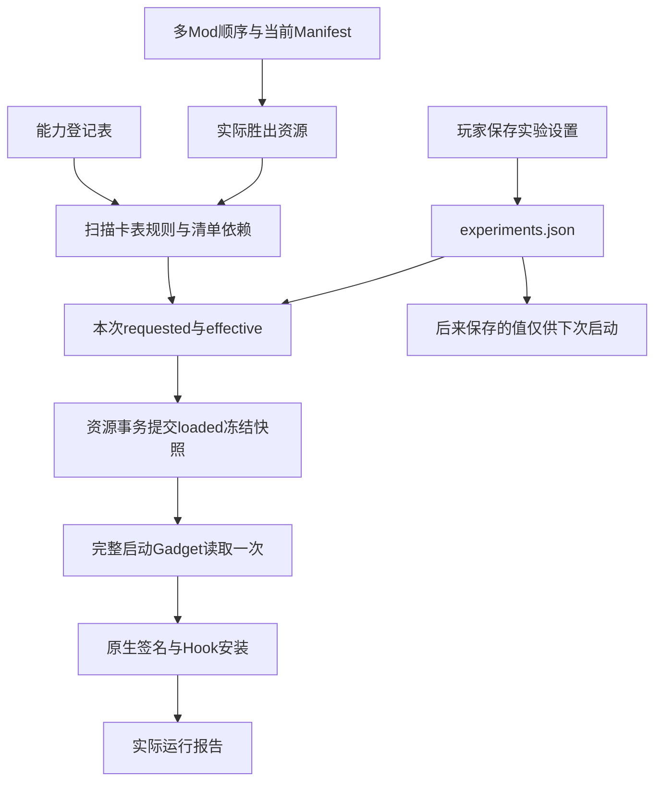

# 资源、保存设置、冻结输入与实际状态

本页对应2026-10-20 R12产品合同。普通原版卡牌继续使用原版JSON组件；只有卡牌实际携带私有规则、匹配Gadget支持该规则且本次启动获得许可时，才执行相应扩展。

## 1. 各文件负责什么

| 对象 | 作用 | 与其他对象的关系 |
| --- | --- | --- |
| Mod原始ZIP | 分发、来源与回溯依据，原件只读保存 | 内容按逻辑资源族映射，整文件优先，不按GUID自动合并 |
| 当前官方Manifest | 确定逻辑资源的Bundle编号与目录 | 不能用ZIP旧数字后缀或数字最大值替代当前清单 |
| 胜出的 `cards/card_data` | 属性、原版触发/查询/效果和私有规则标记 | 从实际采用Bundle扫描需求与具体GUID，不按Mod名字猜测 |
| 胜出的 `loc/cn` | 名称、技能说明、小故事等文字 | 中文改变不会自动改变技能；独立文本与美术复用仍按第23章处理 |
| 胜出的 `data_assets` | 关卡、场景能力等原版数据 | 三资源创作范围保持，不因此开放任意原生类型 |
| APK资产 `experiments/capabilities.json` | 能力ID、版本、规则、参数、运行和AI支持的唯一登记 | 是合同数据，不是用户偏好，不执行代码 |
| 匹配的Gadget运行时 | 在相应原生时机解释私有标记，使用原版效果与队列 | 需匹配游戏二进制和登记revision，单独复制数字不会增加能力 |
| `mod.json.required_capabilities` | Mod声明的能力ID及最低版本 | 声明不会强制开启设置或下载代码 |

核心资源仍位于应用外部目录的 `cache/bundles/files/` 下；具体版本号由当前Manifest决定。启动器设置和收据在 `cache/launcher/`，它们不是Unity Bundle。资源寻址的完整链见[第23章02](../../23.卡牌身份与资源映射/02.Manifest、Bundle与内部资产.md)。

多Mod先按顺序确定胜出的整张卡表，再扫描其 `GrantAbilityEffectDescriptor.GrantableAbilityType`。被覆盖Mod的清单声明单独标明“清单声明，未必实际使用”，不能把未采用卡表中的规则说成已经加载。卡表、中文和关卡仍各自整文件靠前优先。

## 2. 三层状态

| 层次 | 位置 | 表达的事实 |
| --- | --- | --- |
| 保存 | `cache/launcher/experiments.json` | 玩家下次希望使用什么，包含schema、修订号、四个严格布尔值和迁移来源 |
| 启动采用 | `loaded.json.capability_snapshot`，设置原件另存 `experiments_loaded` | 随资源事务提交的冻结输入：requested/effective、登记revision、实际需求、缺失项、允许规则 |
| 实际运行 | `cache/launcher/runtime-capabilities.json` | 原生签名及Hook安装、枚举保护、各规则active、模块状态和错误 |

保存不等于启动已采用，启动许可也不等于Hook成功。原版入口把本次游戏扩展、六路、AI接管关闭；AI作者许可从保存设置另行计算，不能因上次进入原版而禁止编辑新Mod。

报告必须同时匹配schema、`loaded.transaction_id`与当前进程PID，还记录Gadget会话ID。相同资源事务可能跨多个冷启动复用，仅比事务ID会误读旧进程状态。报告缺失、过旧或损坏时，界面表示尚不能核实，不拿设置中的“开启”冒充实际安装成功。

RC2报告通过独立临时文件、flush/close和同目录libc rename原子发布；publish合并重入并限制单次工作量。写失败保留旧完整报告及error，避免较短JSON残留或读取到半份文件。该文件始终是诊断输出，不是启动输入。

## 3. 冷启动、事务与迁移

启动器和悬浮窗统一调用 Java `NativeExperiments.read(Context)`、`setFlag(Context,String,boolean)`。同步保存合并单个开关，避免两入口读改写覆盖其他偏好。六路和AI接管保留原有PvE适用范围，所有玩法变更都需下一次完整启动。

冻结快照是原子loaded收据的一部分，没有额外独立的启动输入文件。卡表、中文、关卡、已管理清单、兼容收据与loaded一起提交或恢复。提交中保存的较新偏好留待以后采用；资源失败不会把用户刚保存的设置回滚。切换后恢复原值时不显示功能待重启，修订差异仍可单列。

新安装四项默认关闭：扩展技能包、AI扩展创作、六路PvE、PvE AI接管。R11已加载或已勾选声明Mod2时，首次迁移保留扩展总开关，其他三项不追加授权。仅在没有权威loaded收据时使用旧 `cache/mod2/profile.json` 后备；迁移后以玩家保存值为准，不因再次导入Mod自动开启。

总开关关闭不清除单独保存的AI偏好，但实际AI创作许可要求两者同时开启。保存设置不卸载本局Hook、不改变现有六路线路、不改写已经排队的技能。

## 4. 依赖警告与保护

能力关闭、未知或最低版本不足时，计划显示ID、原因和来源，允许用户继续。关闭能力不改写ZIP，也不自动把中文或卡表还原成原版。Bundle损坏、路径越界、非整数/越界规则、实际部署失败属于技术失败，不能显示成已应用。

匹配Gadget先安装自定义Grant枚举保护，再安装可选技能Hook。未知或禁用的 `>=1000` 数值被拦截，不回落原版枚举执行；原版数值照常处理。核心Hook部分安装失败后整包inactive，状态保留部分安装记录。保护Hook自身签名失配则明确报错，不能声称此时仍有枚举保护。

RC2启动先校验并安装唯一native ExecuteTasks replacement，第一次UnityMain帧才做managed模块和上下文初始化；不靠固定睡眠在Gum线程调用managed API。初始化仅尝试一次，失败记录phase/stack并将能力实际层标为core-failed，后续帧仍调用原版方法。晚注册扩展也等Unity帧；这些结构约束不等于所有冷启动竞态已经实机穷尽。

原 `mod2_runtime` 和 `runtime:["mod2"]` 只保留旧链路兼容；当前执行许可来自冻结的全局设置，不按Mod/ZIP名称授权。运行时目录保留mod2来源名，不意味着只允许Mod2使用。

## 5. 安全启动的前置条件

本轮建立了唯一登记、明确版本、依赖来源、默认关闭、冻结启动输入、实际安装报告、失败不启用扩展和未知规则拦截。这些可以作为后续降级策略的输入。

完整安全启动尚未实现：没有崩溃计数、自动救援模式、自动禁用上次能力、自动回退全部资源/用户数据、独立救援APK或一定能进入游戏的保证。当前缺能力仍可进入是明确的组合政策，不应由后续Agent擅自改成隐含强制限制。
