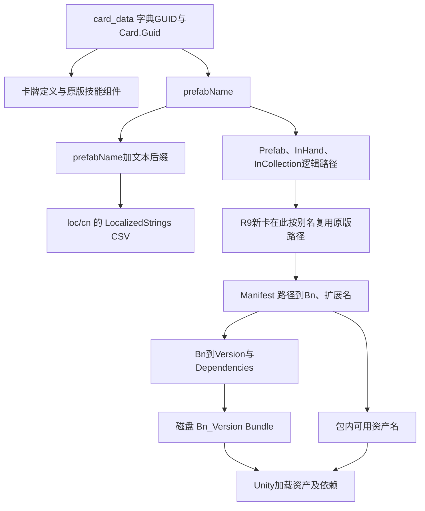

# 23. 卡牌身份与资源映射

本章整理 2026-10-19 R9 制作与真机验收经验，回答三个问题：卡牌编号与美术标识有什么区别；名称、手牌图、战场单位如何找到各自资源；新增 GUID 如何复用原版资源并拥有独立文字。

前四篇保留R9当时的制作与验收；后续R10拥有权及R11玩家身份／流程见[第05篇](05.本地新卡身份与服务器裸GUID边界.md)，不回写成R9当时已完成。

结论是：**数字 GUID 标识卡牌定义，`prefabName` 同时参与文本键和资源路径生成；Manifest 把资源路径映射到 Bundle，Bundle 内还要找到正确的资产名与依赖。** 新增 GUID 本身不会自动创建中文、美术、收藏或卡组库存记录。

| 阅读内容 | 解决的问题 |
|---|---|
| [01.身份、文本与技能的关系](01.身份、文本与技能的关系.md) | GUID、UUID外观字符串、prefabName、中文Key、运行中实体ID分别是什么 |
| [02.Manifest、Bundle与内部资产](02.Manifest、Bundle与内部资产.md) | 逻辑路径→Bn→Version→磁盘文件→内部资产与依赖；卡面与图鉴为何可能分包 |
| [03.新增GUID与资源复用流程](03.新增GUID与资源复用流程.md) | 只改原卡、共享prefab、独立文本+资源别名的选择；R9写回和多Mod部署合同 |
| [04.R9验收与失败边界](04.R9验收与失败边界.md) | 3次真实API、70项游戏检查、错误及修正、尚未验证的内容 |
| [05.本地新卡身份与服务器裸GUID边界](05.本地新卡身份与服务器裸GUID边界.md) | R10拥有权、R11命名空间／预约／玩家过渡及最终证据；原版、fixture与官方同步分层 |
| [06.可配置新卡获取与手机Mod列表](06.可配置新卡获取与手机Mod列表.md) | R26获取开关/数量、Token排除、真实库存持久化与手机封面列表；主机、UI与冷启动证据分开 |
| [07.原版资源名校验与自动获取启动故障](07.原版资源名校验与自动获取启动故障.md) | R28合法空格/单引号、650/646/4分组、可信模板白名单及初始化先失败导致补卡未安装；实机结果单列 |
| [08.本地新卡连续性与同账户保护](08.本地新卡连续性与同账户保护.md) | R29预Unity已有数量证明、缺键与显式0、同账户／身份／缓存路径及精确Sync边界；RC2恢复观察不等于稳定或官方云同步已验 |
| [验收摘要.json](验收摘要.json) | 筛选后的机器证据、当前Manifest样例及来源指纹 |
| [Agent14](../agents/14-card-identity-and-assets.md) | 给后续Agent的调查、实施与验收顺序 |
| [Agent15](../agents/15-multimod-player-lifecycle.md) | 多Mod资源导入、本地身份、显式clone和正式玩家流程 |

## 先看整体关系

图中的资源别名是 **R9新增的加载适配**，不是原版JSON自带字段。卡牌技能仍使用已登记原版组件；资源寻址需要适配，与增加私有技能是两个不同层次。R9没有修改官方Manifest或bin，也没有增加新图片或音频。

## 与已有章节的关系

- 第[02章](../02.卡牌数据说明/README.md)讲卡表与技能树，本章说明卡表如何连接到其他资源。
- 第[03章](../03.本地化说明/README.md)讲CSV、共享标记与翻译，本章说明新卡的文本前缀。
- 第[04章](../04.贴图简单修改/README.md)讲已有贴图替换，本章补当前清单和包内资产的定位链。
- 第[22章](../22.自然语言原版制卡/README.md)公开的是独立Python制作核心v1；本章记录后续独立Android R9产品经验，**没有把R9的新合同移植进该公开工具**。
- 后续R12全局技能许可见[第21章08](../21.语义调试与技能扩展实战/08.实验能力登记与冷启动许可/README.md)。新卡身份、文本和美术寻址与技能运行许可仍是不同层次，登记一个扩展不会自动创建收藏或资源。

## 归档范围

本章提供关系说明、数据合同示意和筛选证据；不包含R9完整运行时、Android工程、APK、签名文件、游戏Bundle或账户日志。来源位置只作工作区追溯，不要求读者拥有本机工程。2026-10-19这次入库仅整理已有结果，没有重新调用API或连接设备。

以下为R9当时的未验证范围：Manifest.bin编解码及加载优先级、真正新增美术、全部原版技能组合、新GUID的收藏/组牌持久化和热更新。不能从R9旧记录推出这些能力完成；R10／R11后续结果按[第05篇](05.本地新卡身份与服务器裸GUID边界.md)独立判断。
