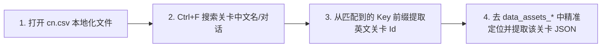

# 01. 关卡存储路径与中文映射查找

在 PVZH 中，所有的单人关卡、随机挑战与剧情解密关卡均存放在 `data_assets_*` 数据包中。

本篇讲解关卡的存储路径特征以及**如何在 `cn.csv` 中根据中文名精确定位关卡 ID**。

当前任务范围、证据指纹和已知错误先读[关卡资料唯一入口](INDEX.md)。本篇于2026-10-25纠正了“编号最大包优先”的旧说法。

---

## 一、 关卡资源存放路径

在安卓设备或模拟器中，关卡资源包存放于：

```text
/storage/emulated/0/Android/data/com.ea.gp.pvzheroes/files/cache/bundles/files/data_assets_*
```

### 有多个底包时，先确定游戏实际使用的版本
在缓存目录下可能存在多个 `data_assets_*` 文件（例如 `data_assets_38`、`data_assets_39`、`data_assets_40`）：
- 当前启动器依据 `cache/manifest/manifest_version` 及该版本 `AssetPathsManifest` 的 `BundleNameToDetails` 定位有效文件，不能按缓存后缀数值最大来猜测。
- `tools/level-editor/unity_manager.py` 自己采用“后缀数字从大到小、重复关卡保留先读项”的本地扫描策略。这是工具选输入的规则，不是已证明的游戏加载规则。
- 先记录输入版本、逻辑资源族、实际文件名与SHA，再读取目标TextAsset。写回部署也必须对应有效清单；同名或较大编号的旧缓存不能替代该核对。

---

## 二、 核心技巧：在 `cn.csv` 中反查关卡 ID

在 `data_assets_*` 资源包中，每个关卡表现为一个 JSON 格式的 `TextAsset`，但名称均为英文 ID 标识。如果你想修改某关特定中文名称的关卡，请使用以下高效的反查技巧：

### 操作步骤：



1. **搜索中文文本**：
   打开本地化文件 [cn.csv](../../资源/cn.csv)，按下 `Ctrl+F` 搜索你要查找的关卡中文名称、剧情对话或关卡提示文字。
2. **提取关卡 Id**：
   在匹配到的文本条目左侧，观察其 Key 的前缀字符串。例如找到剧情对话 Key，其前缀就是该关卡在 `data_assets_*` 包内的真实英文 **`Id`**。
3. **定位 AssetBundle 节点**：
   拿着反查到的英文 `Id`，在当前有效底包中核对同名TextAsset、JSON的`Id`及玩家阵营；中文可能复用或重名，搜索命中不等于目标已经唯一。植物／僵尸任务1～200的编号映射与补零规则见[索引](INDEX.md#任务定位)。
