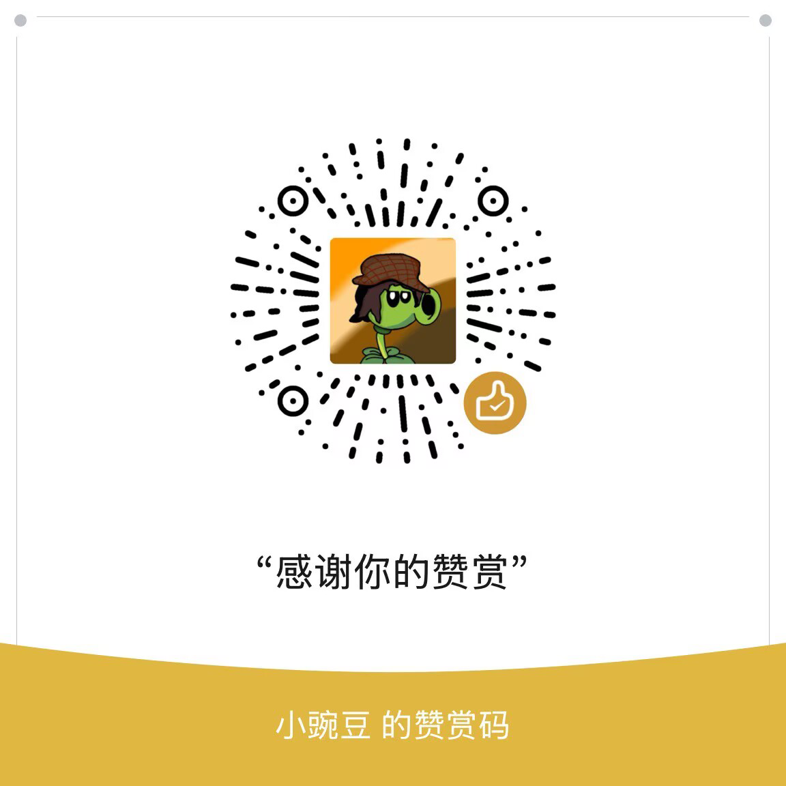

# PVZH Library

A Chinese-language knowledge base of documentation, tools, and practical experience for **Plants vs. Zombies Heroes (PVZH)** mod developers.

The current mobile product entry point is **Launcher stable v1 (internal R51)**. The primary maintenance evidence window is R42–R51 and stable v1. Older R-series chapters preserve their original structure, implementation sources, and troubleshooting knowledge; statements such as “current” and test results apply only to the version documented at the time. This library provides documentation, public tools, and curated reference material. It does **not** include the complete Android launcher project, APK, debugging service, accounts, or signing credentials. Cloning this repository does not mean you can build the launcher.

> **Language note:** This README is an English guide to the repository. Most documentation is currently written in Chinese; the links below lead to the original materials unless an English translation is explicitly provided.

[简体中文 README](README.md)

## Start here

| If you want to... | Start with... |
| --- | --- |
| Find any document, including older references, tool internals, and test records | [Document index](文档总索引.md) · [Machine-readable catalog](DOCUMENT-CATALOG.json) |
| See what stable v1 currently supports and what has not been tested | [Current capabilities](24.启动器工作台与手机编辑/05.当前版本能力.md) |
| Troubleshoot launch failures, crashes, errors, or features that do not work | [Troubleshooting and pitfalls](24.启动器工作台与手机编辑/06.故障排查与避坑.md) |
| Learn about mobile card authoring, component blocks, Quick/Expert modes, assets, and media | [Chapter 24](24.启动器工作台与手机编辑/README.md) |
| Create your first mod | [Introduction](前言.md) → [Toolchain](01.工具链介绍/README.md) → [Standalone basic walkthrough](agents/08-basic-mod-walkthrough.md) |
| Use an AI agent to carry out tasks | [Agent entry rules](AGENTS.md) → [Task routing](agents/README.md) |
| Look up original card, level, or localization data | [Card data](02.卡牌数据说明/README.md) · [Level index](09.关卡修改/INDEX.md) · [Localization](03.本地化说明/README.md) |
| Check licenses, authorship, and migration sources | [License index](LICENSES.md) · [Terms of use](许可与使用条款.md) · [Migration record](MIGRATION.md) |

The Android product, public Python tools, and capabilities of the original game are three separate scopes. A component that can be edited manually is not necessarily exposed through an AI tool. Likewise, a feature unsupported by a particular tool is not proof that the original game engine cannot do it. Static/local tests, real Android UI tests, original-engine tests, live-match tests, and tests with real models are documented separately.

## Tools and mods

| Project | Entry point | Scope |
| --- | --- | --- |
| Card Editor / Phantom Engine | [tools/card-editor](tools/card-editor/README.md) | Desktop Python tools for card JSON, skill trees, and Bundles; this is not the mobile editor |
| Level Editor | [tools/level-editor](tools/level-editor/README.md) | Python tools for level configuration, events, and Bundles |
| Audio Tool | [tools/audio-tool](tools/audio-tool/README.md) | Audio extraction, conversion, and replacement; prepare external tools as described in its documentation |
| Paper-doll asset tool | [tools/auto-paper-doll](tools/auto-paper-doll/README.md) | Experimental prototype for reskinning Unity character assets; full reference validation has not yet passed |
| Local Inventory Mod | [mods/local-inventory](mods/local-inventory/README.md) | Standalone static patch and local card-library contract; not the launcher's runtime |
| Natural-language original-card authoring core | [tools/natural-card-author](tools/natural-card-author/README.md) | Constrained plan → original-game components / Chinese text / Bundle workflow; see its own v1 contract |

Each tool has its own dependencies, inputs, outputs, and license. Open the relevant subdirectory and read its README before installing anything. Original game data must be supplied by the user.

## Documentation map

| Chapter | Topics |
| --- | --- |
| [00. Game introduction](00.游戏介绍/README.md) | Engine versions, asset directories, and beginner pitfalls |
| [01. Toolchain](01.工具链介绍/README.md) | AssetStudio, UABEA, Unity, mobile workflows, and community tools |
| [02. Card data](02.卡牌数据说明/README.md) | Card JSON, component structures, skill logic trees, and copyable templates |
| [03. Localization](03.本地化说明/README.md) | Localization files, shared markers, batch translation and name synchronization, practical Chinese-language packs, and validation boundaries |
| [04. Basic texture editing](04.贴图简单修改/README.md) | Finding, exporting, and replacing textures; dimensions and formats |
| [05. Intermediate texture editing](05.贴图中级修改/README.md) | A/B bundles, pointer redirection, node insertion, and troubleshooting |
| [06. Animation editing](06.动画修改/README.md) | Unity 2D animation, motion redirection, and practical analysis |
| [07. Audio editing](07.音频修改/README.md) | Locating audio, replacing WEM/SoundBank files, extracting and arranging BGM, and dynamic verification |
| [08. Adding a video component](08.加入新组件-视频/README.md) | VideoPlayer injection, PPtr rebinding, and mesh handling |
| [09. Level editing](09.关卡修改/README.md) | Level JSON, story events, and visual editing |
| [10. Decks and AI deck-building](10.卡组与AI构筑修改/README.md) | Deck structures, AI deck-building, and local debugging |
| [11. Advanced static techniques](11.静态高级实战/README.md) | Static patching of `libil2cpp.so` and merging local card libraries |
| [12. Advanced static techniques II](12.静态高级实战2/README.md) | Extending Mod Base capabilities, Grant armor, and dual-track UI |
| [13. Combining texture assets](13.贴图资源拼接/README.md) | Reconstructing Unity 2D parts, assembling idle first frames, and batch Python scripts |
| [14. Extracting animation assets](14.动画资源提取/README.md) | Offline AnimationClip reconstruction, fixed-canvas rendering, MP4/MOV, and batch extraction |
| [15. Exploring dynamic runtime behavior](15.动态运行时初探/README.md) | Frida instrumentation, IL2CPP symbol mapping, and dual-track Hook basics |
| [16. Rootless mobile deployment](16.免Root移动端落地/README.md) | Embedding Frida Gadget, Smali startup interception, and long-term signing practices |
| [17. Dynamic interaction with the Unity engine](17.Unity引擎动态交互/README.md) | Unity thread safety and practical UnitySynchronizationContext scheduling |
| [18. Hybrid development with modern native floating UI](18.现代原生浮窗UI混合开发/README.md) | Native floating-window architecture, avoiding render-loop deadlocks, and scrollbar pitfalls on newer Android versions |
| [19. Benign modding: offline deck sharing](19.良性Mod实战-离线卡组分享/README.md) | PVZH1 protocol design, card compliance validation, and native persistence |
| [20. Improving the engineering experience: asset gatekeeping and tutorial skipping](20.工程体验跃迁-资源门卫与教程跳过/README.md) | Pre-Unity asset gatekeeping, full asset/FTUE handling, original/mod2 switching, and delivery validation |
| [21. Semantic debugging and practical skill extensions](21.语义调试与技能扩展实战/README.md) | Coordinate-free testing, cache and Gadget contracts, effect ownership, history/animation, R19 validation, combined actions, global experimental capabilities, and cold-start permissions |
| [22. Natural-language original-card authoring](22.自然语言原版制卡/README.md) | Original-game knowledge index, AI planning contract, deterministic compilation, DeepSeek evaluation, and future UI/Hook boundaries |
| [23. Card identity and asset mapping](23.卡牌身份与资源映射/README.md) | GUID / prefabName / Chinese keys, manifests and Bundle assets, reuse of original assets for historical R9 cards, cumulative editing, and real-device evidence |
| [24. Launcher workbench and mobile editing](24.启动器工作台与手机编辑/README.md) | Stable v1 / R51 capabilities and troubleshooting; R42–R51 stages, manual components, AI modes, and R48 UI references |
| [Assets](资源/) | Example files, indexes, older notes, and practical materials |
| [Agent guide](agents/README.md) | Basic authoring, runtime skill workflows, semantic testing, evidence boundaries, device fallback, and standalone walkthrough |

## Usage notes

This repository is intended for technical research, learning, discussion, and documentation. It is not affiliated with EA, PopCap, or the official *Plants vs. Zombies Heroes* project. Game names, characters, and related assets remain the property of their respective rights holders. Do not use this material to disrupt game services, harm other players' experiences, or engage in other prohibited activities.

If a documented procedure does not match your environment, first verify that your game version, Unity version, tool version, and target files are compatible. Contributions that add useful information or correct documentation are welcome through Issues and Pull Requests.

## License

The **original documentation and editorial organization** in the library portion of this repository are licensed under the [Creative Commons Attribution-NonCommercial-ShareAlike 4.0 International License (CC BY-NC-SA 4.0)](https://creativecommons.org/licenses/by-nc-sa/4.0/).

| File | Description |
| --- | --- |
| [LICENSES.md](LICENSES.md) | License boundaries; four imported projects retain their MIT licenses and original author notices |
| [LICENSE](LICENSE) | Formal license declaration (CC BY-NC-SA 4.0) |
| [Chinese terms of use](许可与使用条款.md) | Detailed terms in Chinese, including attribution, non-commercial boundaries, and restrictions on repackaging and misattributed donations |

**You may:** use the material for personal learning, redistribute it non-commercially, and adapt and republish it under the same license with proper attribution.  
**You must:** retain attribution to the author (休切尔 / Show-o4210), the work title “PVZH Library,” the official repository link, and the license notice.  
**You may not:** remove attribution and repackage the entire work, impersonate the original author, sell this documentation as a paid product, or remove its source and redirect donations to yourself.

The original content in `tools/card-editor/`, `tools/level-editor/`, `tools/audio-tool/`, and `mods/local-inventory/` is separately licensed under the MIT license in each directory. The non-commercial and ShareAlike conditions above apply only to content covered by the library's CC license.

Official game assets, exported game data, and third-party tools are **not** covered by this license. For the complete terms, see [许可与使用条款.md](许可与使用条款.md).

```text
Author: 休切尔 (Show-o4210)
License: CC BY-NC-SA 4.0
Official repository: https://github.com/Show-o4210/PVZH-Library
Homepage: https://github.com/Show-o4210
```

## Support the author

Organizing, verifying, and writing this material takes a considerable amount of time. If this little library has helped you, you are welcome to buy the author a drink. Donations are entirely voluntary. Thank you for your support!

<p align="center">
  
</p>

> The donation channel shown above belongs to the original author only. Third-party mirrors that display payment information must clearly identify the original author and link to the official repository. They must not impersonate the author. See [许可与使用条款.md](许可与使用条款.md).

---

May every pitfall you encounter become a stepping stone for those who come after you.
