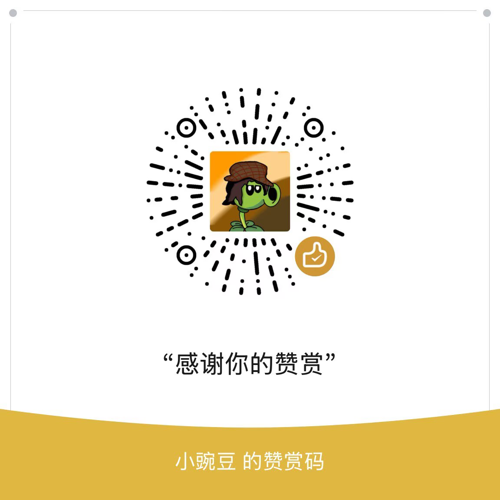

# PvZ Heroes Advanced Modding Library

[English](README.md) | [简体中文](README_zh_CN.md) | Tiếng Việt 

PvZ Heroes Advanced Modding Library (Thư viện Modding Nâng cao PvZ Heroes) là kho tư liệu, công cụ và kinh nghiệm dành cho các nhà phát triển mod của **Plants vs. Zombies Heroes (PVZH)**.

Phiên bản ổn định hiện tại trên điện thoại là **v3.1 (mốc tính năng r-2-22 RC1)**. [Bảng ngôn ngữ tiếng Việt của trình khởi chạy](pvzh-launcher/README.md) trong bản ứng viên phát triển **r-2-32 RC1** đã được mở để rà soát bản dịch. Các hướng dẫn về tính năng và khắc phục sự cố ghi nhận phạm vi kiểm chứng đến r-2-28 RC1. Kho này tập hợp các hướng dẫn bằng tiếng Trung, công cụ công khai và bằng chứng đã được chọn lọc. Các đường dẫn được đánh dấu là “không gian làm việc” (工作区) dùng để truy lại hồ sơ bàn giao trong không gian làm việc đầy đủ.

> **Lưu ý về ngôn ngữ:** README này là hướng dẫn bằng tiếng Việt cho kho mã. Phần lớn tài liệu hiện được viết bằng tiếng Trung; các liên kết bên dưới dẫn đến tài liệu gốc, trừ khi có ghi rõ bản dịch.

## Bắt đầu từ đây

| Nhu cầu | Điểm bắt đầu nhanh nhất |
| --- | --- |
| Tìm bất kỳ tài liệu nào, bao gồm tài liệu tham khảo cũ, hướng dẫn nội bộ của công cụ và hồ sơ kiểm tra | [Mục lục tài liệu](文档总索引.md) · [Danh mục cho máy đọc](DOCUMENT-CATALOG.json) |
| Xem phiên bản ổn định, bản ứng viên phát triển và phạm vi đã kiểm thử thực tế | [Tính năng của các phiên bản hiện tại](Library-docs/24.启动器工作台与手机编辑/05.当前版本能力.md) |
| Xử lý lỗi không vào được trò chơi, văng ứng dụng, thông báo lỗi hoặc tính năng không hoạt động | [Khắc phục sự cố và các lỗi cần tránh](Library-docs/24.启动器工作台与手机编辑/06.故障排查与避坑.md) |
| Tạo thẻ, chỉnh sửa hình ảnh, dùng AI và quản lý tài nguyên trên điện thoại | [Chương 24](Library-docs/24.启动器工作台与手机编辑/README.md) |
| Tìm hiểu dự án trình khởi chạy hoặc tham gia dịch giao diện | [Trình khởi chạy PVZH](pvzh-launcher/README.md) |
| Tạo mod lần đầu | [Lời mở đầu](Library-docs/前言.md) → [Bộ công cụ](Library-docs/01.工具链介绍/README.md) → [Ví dụ cơ bản độc lập](Library-docs/08-basic-mod-walkthrough.md) |
| Thực hiện nhiệm vụ với vai trò Agent | [Quy tắc dành cho Agent](AGENTS.md) → [Hướng dẫn chọn tài liệu theo nhiệm vụ](agents/README.md) |
| Tra cứu dữ liệu thẻ, màn chơi hoặc bản địa hóa của trò chơi gốc | [Dữ liệu thẻ](Library-docs/02.卡牌数据说明/README.md) · [Mục lục màn chơi](Library-docs/09.关卡修改/INDEX.md) · [Bản địa hóa](Library-docs/03.本地化说明/README.md) |
| Tra cứu giấy phép, tác giả và nguồn nhập tài liệu | [Mục lục giấy phép](LICENSES.md) · [Điều khoản sử dụng](许可与使用条款.md) · [Lịch sử chuyển vào kho](MIGRATION.md) |

Sản phẩm Android, các công cụ Python công khai và khả năng của trò chơi gốc thuộc ba phạm vi riêng biệt. Một thành phần có thể chỉnh sửa thủ công không có nghĩa là đã được cung cấp qua công cụ AI; việc một công cụ chưa hỗ trợ tính năng nào đó cũng không có nghĩa là engine của trò chơi gốc không làm được. Kiểm tra tĩnh hoặc trên máy cục bộ, kiểm thử giao diện Android trên thiết bị thật, kiểm thử engine gốc, kiểm thử trong trận đấu thực tế và kiểm thử với mô hình AI thật được ghi nhận riêng.

## Công cụ và mod

| Dự án | Điểm truy cập | Phạm vi chức năng được công bố |
| --- | --- | --- |
| Card Editor / Phantom Engine (幻影引擎) | [tools/card-editor](tools/card-editor/README.md) | Công cụ Python trên máy tính cho JSON thẻ, cây kỹ năng và Bundle; không phải trình chỉnh sửa trên điện thoại |
| Level Editor | [tools/level-editor](tools/level-editor/README.md) | Công cụ Python cho cấu hình màn chơi, sự kiện và Bundle |
| Audio Tool | [tools/audio-tool](tools/audio-tool/README.md) | Trích xuất, chuyển đổi và thay thế âm thanh; chuẩn bị các công cụ bên ngoài theo hướng dẫn của dự án |
| Công cụ tài nguyên nhân vật ghép mảnh | [tools/auto-paper-doll](tools/auto-paper-doll/README.md) | Nguyên mẫu thử nghiệm thay diện mạo tài nguyên nhân vật Unity; chưa vượt qua kiểm tra đầy đủ các tham chiếu |
| Local Inventory Mod | [mods/local-inventory](mods/local-inventory/README.md) | Bản vá tĩnh độc lập và đặc tả kho thẻ cục bộ; không phải runtime của trình khởi chạy |
| Lõi tạo thẻ cho trò chơi gốc bằng ngôn ngữ tự nhiên | [tools/natural-card-author](tools/natural-card-author/README.md) | Quy trình có ràng buộc: plan → thành phần của trò chơi gốc / văn bản tiếng Trung / Bundle; đánh giá theo đặc tả v1 riêng của công cụ |

Mỗi công cụ có các phụ thuộc, đầu vào, đầu ra và giấy phép riêng. Hãy vào thư mục con tương ứng và đọc README trước khi cài đặt theo nhu cầu; người dùng phải tự cung cấp dữ liệu của trò chơi gốc.

## Hướng dẫn và tài liệu tham khảo

- [Mục lục hướng dẫn Library-docs](Library-docs/README.md) tập hợp các chương 00–24, ví dụ nhập môn và hướng dẫn cũ.
- [Tài nguyên](资源/) tập hợp các chỉ mục dữ liệu, tư liệu thực hành và ghi chú tham khảo cũ.
- [Hướng dẫn làm việc cho Agent](agents/README.md) cung cấp cách chọn tài liệu theo nhiệm vụ, kiểm thử ngữ nghĩa và giới hạn của phạm vi kiểm chứng.

## Hướng dẫn sử dụng

Kho này phục vụ nghiên cứu kỹ thuật, học tập, trao đổi và lưu trữ tư liệu; không có quan hệ liên kết với EA, PopCap hay dự án chính thức *Plants vs. Zombies Heroes*. Quyền đối với tên trò chơi, nhân vật và các tài nguyên liên quan trong kho thuộc về các chủ sở hữu tương ứng. Không sử dụng tài liệu để phá hoại dịch vụ trò chơi, ảnh hưởng đến trải nghiệm của người khác hoặc thực hiện các hành vi vi phạm khác.

Nếu các bước trong tài liệu không phù hợp với môi trường của bạn, trước tiên hãy kiểm tra phiên bản trò chơi, phiên bản Unity, phiên bản công cụ và tệp đích có khớp với hướng dẫn hay không. Hoan nghênh việc bổ sung tư liệu và sửa tài liệu qua Issue hoặc Pull Request.

## Giấy phép

**Tài liệu nguyên gốc và cách tổ chức nội dung** thuộc phần thư viện tư liệu ban đầu của kho này được cấp phép theo  
[Creative Commons Ghi công – Phi thương mại – Chia sẻ tương tự 4.0 Quốc tế (CC BY-NC-SA 4.0)](https://creativecommons.org/licenses/by-nc-sa/4.0/deed.zh-hans).

| Tệp | Mô tả |
| --- | --- |
| [LICENSES.md](LICENSES.md) | Phạm vi áp dụng của các giấy phép theo thư mục; bốn dự án được nhập vào kho giữ nguyên giấy phép MIT và thông báo tác giả gốc |
| [LICENSE](LICENSE) | Tuyên bố giấy phép chính thức (CC BY-NC-SA 4.0) |
| [许可与使用条款.md](许可与使用条款.md) | **Điều khoản chi tiết bằng tiếng Trung**: cách ghi công, giới hạn phi thương mại, cấm đóng gói lại để mạo nhận tác giả và thay mã nhận tiền, cùng các điều khoản khác |

**Bạn được phép:** học tập và sử dụng cá nhân, đăng lại và chia sẻ phi thương mại, sửa đổi rồi phát hành lại với điều kiện ghi công và sử dụng cùng giấy phép.  
**Bạn phải:** giữ lại tên tác giả (休切尔 / Show-o4210), tên tác phẩm “PVZH 图书馆” (Thư viện PVZH), liên kết kho chính thức và thông báo giấy phép.  
**Bạn không được:** xóa thông tin ghi công rồi đóng gói lại toàn bộ tác phẩm dưới diện mạo khác, mạo danh tác giả gốc, bán tài liệu này như nội dung chính của một sản phẩm trả phí, hoặc xóa nguồn rồi chỉ gắn mã nhận tiền của mình để chiếm đoạt công sức đã được ghi công.

Nội dung nguyên gốc của các dự án trong `tools/card-editor/`, `tools/level-editor/`, `tools/audio-tool/` và `mods/local-inventory/` được cấp phép riêng theo giấy phép MIT trong từng thư mục. Các điều kiện phi thương mại và chia sẻ tương tự nêu trên chỉ áp dụng cho nội dung thuộc phạm vi giấy phép CC của thư viện.

Tài nguyên chính thức của trò chơi, dữ liệu xuất từ trò chơi và công cụ của bên thứ ba **không nằm trong** phạm vi cấp phép này. Các điều khoản đầy đủ được quy định tại [许可与使用条款.md](许可与使用条款.md).

```text
Tác giả: 休切尔 (Show-o4210)
Giấy phép: CC BY-NC-SA 4.0
Kho chính thức: https://github.com/Show-o4210/PVZH-Library
Trang cá nhân: https://github.com/Show-o4210
```

## Ủng hộ tác giả

Việc tổ chức, kiểm chứng và biên soạn những nội dung này tốn rất nhiều thời gian. Nếu thư viện nhỏ này đã giúp ích cho bạn, bạn có thể mời tác giả một ly nước. Mọi khoản ủng hộ đều hoàn toàn tự nguyện. Cảm ơn sự hỗ trợ của bạn!

<p align="center">
  
</p>

> Kênh nhận ủng hộ trong hình trên chỉ thuộc về tác giả gốc. Nếu bản sao do bên thứ ba duy trì hiển thị thông tin nhận tiền, bản sao đó phải đồng thời ghi rõ tác giả gốc và kho chính thức, không được mạo danh tác giả. Xem chi tiết tại [许可与使用条款.md](许可与使用条款.md).

---

Mong rằng mỗi lần vấp phải khó khăn cuối cùng đều trở thành một cột mốc chỉ đường cho những người đến sau.
